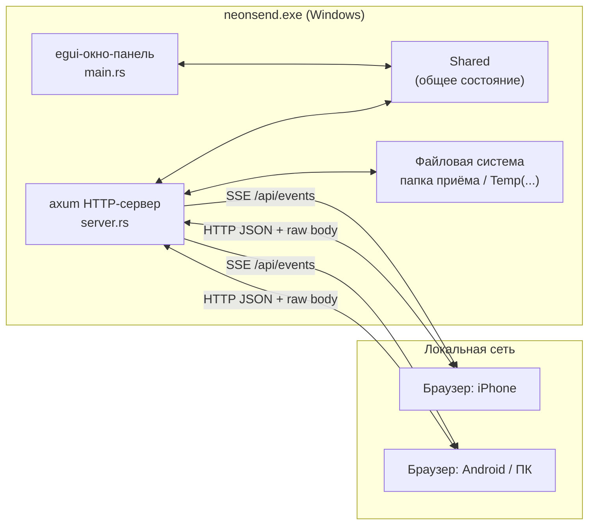
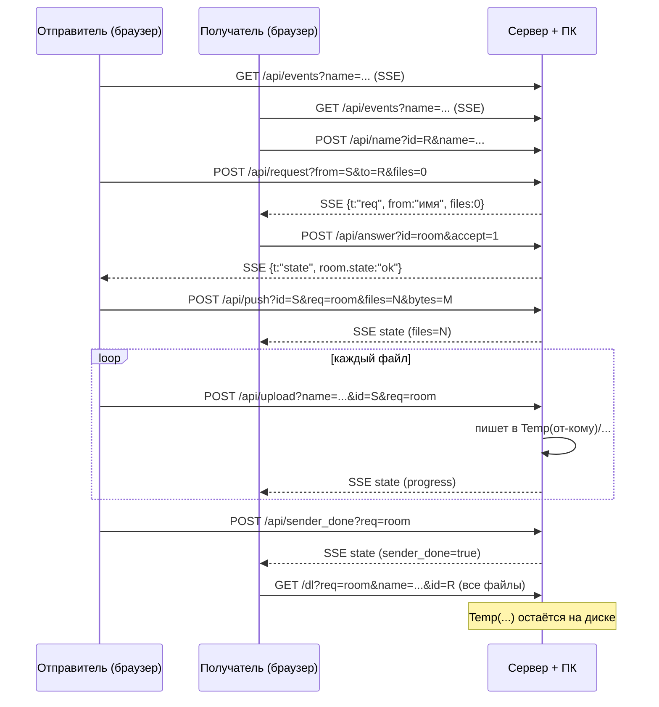
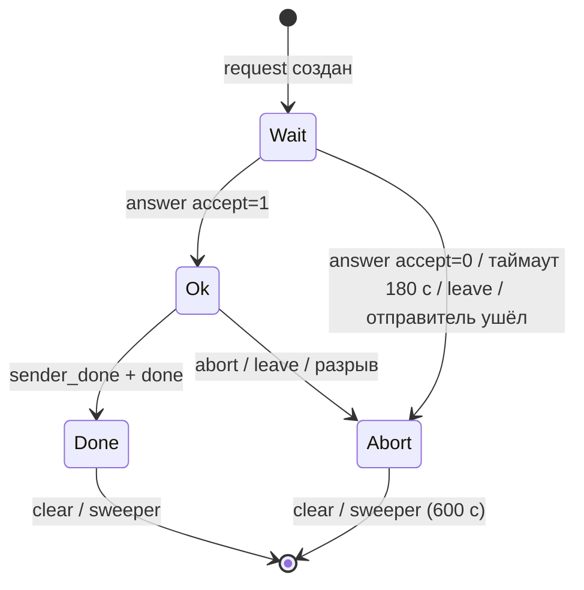

# NeonSend — архитектура

Дата: 16.11.2026. Код: `C:/Users/Pd/Documents/NeonSend`, версия 0.1.0.
Документ описывает **фактическое** устройство кода. Если поведение расходится с
`PROJECT_CONTEXT.md`, верить коду и этому файлу.

---

## 1. Общая схема



Три исполняемых слоя в одном процессе:

1. **UI (egui)** — только панель: QR, адрес, папка, устройства, передачи, журнал. Решений не принимает;
   рисуется под `catch_unwind`, чтобы падение кадра не уронило процесс.
2. **Shared** — единый `Arc<Shared>` с мьютексами: устройства, комнаты, журнал, имена.
   Это единственная точка правды, доступная и окну, и HTTP-слою.
3. **HTTP-сервер (axum/tokio)** — обслуживает страницу и API, пишет файлы.

Компьютер-хозяин участвует в передачах как обычное устройство: браузер, открывший
`http://<адрес этого ПК>:8765`, получает `PC_ID = 0` (определяется по `ConnectInfo`,
адрес сравнивается с адресом, на котором слушает сервер). Подтверждение приёма даётся
на странице в браузере, окно exe в этом не участвует.

---

## 2. Файлы и ответственность

| Файл | Строк | Ответственность |
|---|---:|---|
| `src/main.rs` | 1167 | Окно-панель: панель шапки и панель журнала, логотип, темы, QR, адрес и копирование, папка приёма (по умолчанию `Загрузки\NeonSendTemp`), счётчик, Temp/свободное место, активные передачи, устройства, защита от закрытия; сервер поднимается в `boot()`, окно перезапускается после паники egui |
| `src/server.rs` | 1951 | HTTP-API, SSE, комнаты, текст, загрузка/скачивание файлов, безопасность путей и Origin, юнит-тесты (5) |
| `src/page.html` | 1383 | Браузерный клиент: 4 экрана, дизайн-система (токены), адаптивность, подтверждение приёма со списком файлов, передача текста, drag&drop, прогресс и скорость, удержание экрана, iOS-обход через «Файлы», SSE, темы |
| `build.rs` + `icon.ico` | 42 | Ресурс с иконкой exe (windres → `.rc` → объект) |
| `Cargo.toml` | 22 | Зависимости и release-профиль (`panic` НЕ abort); eframe/egui 0.37 |

`page.html` вкомпилирован в бинарник через `include_str!("page.html")` — правка страницы
требует пересборки.

---

## 3. Состояние (server.rs)

```rust
struct Dev {
    label: String,        // имя, введённое пользователем (или UA-подсказка до ввода)
    named: bool,          // вводил ли пользователь имя
    last: Instant,        // последняя активность (TTL 9 c)
    tx: broadcast::Sender<String>, // канал SSE для всех вкладок этого устройства
    room: Option<u64>,    // текущая комната устройства
}

struct Req {              // комната = одна передача
    from: u64, to: u64,   // id устройств (0 = Этот компьютер)
    state: ReqState,      // Wait | Ok | Done | Abort
    files: u64, bytes: u64,
    files_done: u64, bytes_done: u64,
    err: String,
    since: Instant,       // для таймаутов и sweeper'а
    items: Vec<(String, u64)>, // имена и размеры принятых файлов
    planned: Vec<(String, u64)>, // имена и размеры заявленных в push (до загрузки)
    from_label: String, to_label: String,
    temp: String,         // "Temp(отправитель-получатель-номер-комнаты)"
    sender_done: bool,    // отправитель залил все файлы
    text: String,         // текст, отправленный вместо файлов (до 20 000 символов)
}

pub struct Shared {
    pub root: Mutex<Option<PathBuf>>,   // папка приёма
    pub log: Mutex<Vec<String>>,        // журнал для окна (макс. 500 строк)
    pub received: Mutex<(u64, u64)>,    // счётчик файлов/байт
    devices: Mutex<HashMap<u64, Dev>>,
    by_ip: Mutex<HashMap<String, u64>>, // ip -> устройство (резерв, если нет токена)
    by_token: Mutex<HashMap<String, u64>>, // токен браузера (localStorage) -> устройство
    tok_names: Mutex<HashMap<String, String>>, // токен -> имя (переживает потерю SSE в фоне)
    reqs: Mutex<HashMap<u64, Req>>,
    next: AtomicU64,                    // генератор id
    local: OnceLock<String>,            // адрес сервера: его клиент получает PC_ID
    names: Mutex<HashMap<String, String>>, // ip -> имя (сохраняется на диск)
}
pub const PC_ID: u64 = 0;
```

Ключевые инварианты:

- `ReqState::Done` не может быть переведено в `Abort` (см. `finish_room`).
- Одно устройство = один `broadcast::Sender`; каждая вкладка подписывается на него
  (`d.tx.subscribe()`), поэтому события видят все вкладки и переподключение работает.
- Устройство опознаётся по токену в `localStorage` (`by_token`), адрес — только резерв:
  перезагрузка страницы и новый браузер на том же телефоне сохраняют id.
- `prune()` вызывается в `events`, `devices`, `state_info`, `request` и удаляет устройство
  только по простою > 9 с; если ушедший был отправителем в активной комнате — комната
  переводится в `Abort` с текстом «отправитель закрыл страницу».
  (Проверка `receiver_count() == 0` убрана: на первой же секунде после подключения подписчиков
  могло не быть, и устройство вылетало вместе с комнатой.)
- Имя запоминается и на токен (`tok_names`): Safari на iOS в фоне рвёт SSE, устройство удаляется,
  а адрес может смениться — по токену имя находится снова, и клиенту не приходится вводить его заново.
- Временные папки `Temp(от-получатель-комната)` **никогда не удаляются автоматически**: ни по завершению
  комнаты, ни уборщиком (он чистит только память). Удаление — кнопка «Удалить временные
  папки» в окне; если есть незавершённая комната (`busy()`: `Wait` или `Ok`), окно сначала
  спрашивает подтверждение. Номер комнаты в имени гарантирует, что повторная передача
  между теми же устройствами не смешает файлы.
- `upload`, `/dl`, `/api/part` требуют действующей комнаты: `req` существует, `state == Ok`,
  `id` — участник комнаты, у отправителя не выставлен `sender_done`.
- Завершённая комната (`Done`) отвязывается от обоих устройств (`d.room = None`), поэтому
  новый файл нельзя отправить «в ту же» комнату без нового подтверждения; при `Abort`
  удаляются незавершённые `.part` этой комнаты.
- Комната, где получатель — ПК (`to == PC_ID`), закрывается сама: `maybe_finish` после
  `sender_done`/`progress` ставит `Done`, когда отправитель залил все файлы.
- Клиент, пришедший с адреса, на котором слушает сервер (`Shared::local`), — это `PC_ID = 0`;
  пункт «Этот компьютер» в списке устройств существует только когда такой браузер подключён.
- `push` принимается и в `Wait`, и в `Ok`, сбрасывает `sender_done` и **сохраняет список
  имён и размеров** (`planned`) из тела запроса — получатель видит их в подтверждении
  ещё до загрузки.
- Чтение тела `upload` ограничено простоем 60 с (`tokio::time::timeout` на чанк): зависший
  клиент получает `408`, `.part` остаётся для докачки. Глобального таймаута слоя нет —
  он резал бы SSE и большие файлы.
- Текст вместо файлов: `POST /api/text?id=&req=` (сырое тело, 64 КБ) кладёт строку в `Req.text`
  (до 20 000 символов, управляющие символы отбрасываются), писать может только отправитель
  комнаты в `Wait|Ok`; на странице значение выводится через `textContent`/`.value` — HTML
  не исполняется.
- Занятость: `busy_ids()` отдаёт устройствам поле `busy`, если они заняты чужой комнатой
  (`Wait|Ok`); сам собеседник по своей передаче занятым не считается. `request` отказывает
  при «сам себе», «вы уже в передаче», «устройство занято другой передачей».
- Окно рисуется внутри `catch_unwind` (`App::draw`), `panic` в release не abort, а сервер поднимается
  один раз в `boot()`: если egui падает, окно перезапускается (`run_native` в цикле, до 5 раз),
  а сервер и передачи живут. Падение пишется в `%APPDATA%\NeonSend\crash.log`.

---

## 4. Поток передачи (happy path)



Передача на ПК отличается только тем, что `to == PC_ID`: файлы пишутся сразу в папку
приёма, а подтверждение даётся на открытой в браузере ПК странице (`/api/answer`),
как у любого другого получателя. Окно exe только показывает журнал.

Отмена/выход:



---

## 5. HTTP API (все маршруты)

Общие правила:
- Все ответы — JSON (кроме `/`, `/dl`), заголовок `Content-Type` не всегда выставляется явно.
- Слой `guard` проверяет `Host` и `Origin`/`Referer`: допускаются `{ip}:{port}`,
  `localhost:{port}`, `127.0.0.1:{port}` и те же имена без порта.
- `DefaultBodyLimit::disable()` — размер тела не ограничен (файлы могут быть большими).

| Метод | Путь | Параметры | Назначение |
|---|---|---|---|
| GET | `/` | — | Страница (include_str, `no-store`) |
| GET | `/api/ping` | `id?` | Проверка связи, продление жизни устройства |
| GET | `/api/received` | — | `{files, bytes}` — счётчик принятого |
| GET | `/api/events` | `name`, `token?` | SSE: первым `{t:"hello",id,named,suggest}`, далее `req` и `state` |
| GET | `/api/state` | `id` | `{me, named, suggest, devices[], room|null}` |
| GET | `/api/devices` | `id` | Массив `{id,label,busy}` без себя (`busy` — занят чужой передачей) |
| POST | `/api/name` | `id`, `name` | Сохранить имя устройства (IP берётся из соединения, чужое переименовать нельзя); имя дублируется на токен |
| POST | `/api/request` | `from`, `to`, `files` | Создать комнату (Wait); отказы: сам себе, уже в передаче, устройство занято |
| POST | `/api/answer` | `id`, `accept` | Подтвердить/отклонить |
| POST | `/api/text` | `id`, `req`; тело — сырой текст | Передать текст вместо файлов (64 КБ тело, 20 000 символов), SSE обновляет получателя |
| POST | `/api/push` | `id`, `req`, `files`, `bytes`; тело — JSON `[{name,size}]` | Отправитель выбрал файлы: получатель видит список до загрузки |
| POST | `/api/progress` | `id`, `req`, `files`, `bytes`, `files_done`, `bytes_done` | Обновить прогресс |
| POST | `/api/sender_done` | `id`, `req` | Отправитель залил всё |
| POST | `/api/leave` | `id`, `req` | Выход из сессии (Abort + текст) |
| POST | `/api/abort` | `id`, `req` | Отмена |
| POST | `/api/done` | `req` | Завершить комнату |
| POST | `/api/clear` | `id`, `req` | Убрать комнату с экранов |
| POST | `/api/upload` | `name`, `id`, `req`, `ow?`, `off?`, `last?` | Загрузка файла (тело — сырые байты); нужна комната в `Ok` |
| POST | `/api/exists` | `req?`, тело: JSON-массив имён | `{have:[...]}` — что уже есть (для `Temp` комнаты — в её папке) |
| GET | `/api/part` | `name`, `req` | `{off:N}` — размер `.part` для докачки (только своей комнаты) |
| GET | `/dl` | `name`, `req`, `id` | Скачать файл комнаты (только участнику) |

Коды ошибок: 400 — недопустимый путь/тело, 403 — чужая комната или чужой Origin,
404 — файл не найден, 408 — больше 60 с без данных в `upload`, 409 — файл занят/ошибка
записи, 412 — не выбрана папка приёма.

---

## 6. Работа с файлами

- **Куда пишем:**
  - `to == PC_ID` → `root/<rel>` (папка приёма);
  - иначе → `root/<temp>/<rel>`, где `temp = Temp(отправитель-получатель-номер-комнаты)`.
- **Как пишем:** всегда в `<имя>.part`, после успеха `sync_all()` + `rename` в целевое имя.
  При обрыве соединения `.part` **сохраняется** (нужен для докачки).
- **Докачка:** клиент спрашивает `/api/part?name=...&req=...`, получает смещение и шлёт
  остаток с `off=`. Для больших файлов это экономит трафик после обрыва.
- **Нарезка:** iOS/Safari режет файлы по 8 МБ (`CHUNK`), остальные браузеры шлют целиком.
- **Дубликаты:** `ow=0` пропустить, `ow=1` заменить, `ow=2` переименовать (`free_name`
  добавляет « (1)», « (2)» …).
- **Имена и пути:** `safe_rel_path` разбивает по `/` и `\`, отбрасывает пустые компоненты,
  `.` и `..`, заменяет управляющие символы и `:*?"<>|` на `_`, срезает хвостовые пробелы и
  точки, префиксует зарезервированные имена Windows (`CON`, `PRN`, `AUX`, `NUL`, `COM1…9`,
  `LPT1…9`) подчёркиванием. Длина ограничена (1000 символов на путь).
- **Отдача:** `/dl` стримит файл чанками по 64 КБ, ставит `X-Content-Type-Options: nosniff`
  и `Content-Disposition: attachment` с ASCII-именем и `filename*=UTF-8''…`.

---

## 7. Безопасность (что есть и чего нет)

Реализовано:
- проверка `Host` и `Origin`/`Referer` (защита от CSRF и DNS-rebinding);
- санитайз путей (path traversal, зарезервированные имена, `..`);
- проверка участия в комнате при загрузке, скачивании и докачке: обязательный `req`,
  `state == Ok`, `id` должен совпадать с from/to, у отправителя нет `sender_done`;
- вывод в DOM только через `textContent` (нет innerHTML с пользовательскими данными);
- потоковая запись (файл не грузится в память целиком);
- `Content-Disposition: attachment` + `nosniff` (не исполнять загруженное в браузере).

Не реализовано (осознанно отложено):
- TLS/HTTPS (страница открывается по `http://`);
- токен сессии / cookie / PIN;
- ограничение числа одновременных соединений (есть только таймаут простоя `upload`);
- журнал событий безопасности и rate limiting.

Вывод: модель угроз рассчитана на **доверенную домашнюю сеть**. Любой в той же сети,
кто знает адрес, может открыть страницу и попросить имя; получатель подтверждает приём
вручную — это единственный барьер.

---

## 8. Окно приложения (main.rs)

- Тема хранится в статике `THEME: AtomicUsize`, палитры — `const THEMES: [(&str, Pal); 4]`.
- `App::new` читает конфиг, ставит тему, определяет LAN-IP (`if-addrs` с штрафом за
  vpn/tap/tun/wsl/hyper-v/vmware/vbox/bluetooth/docker), поднимает сервер (порты 8765–8790,
  первый свободный), строит QR. Папка приёма по умолчанию — `%USERPROFILE%\Downloads\NeonSendTemp`
  (создаётся при запуске), если в конфиге нет другой.
- Разметка окна — три панели:
  - `TopBottomPanel::top("head_panel")` — шапка: логотип (шестиугольник с `N` painter'ом),
    «NEONSEND» + «локальная передача файлов» слева с отступом 24, справа «работает/остановлен»
    и пилюля «тема: …» с поповером (4 темы с цветными точками);
  - `CentralPanel` — прокручиваемые карточки: «ПОДКЛЮЧЕНИЕ» (QR на светлой подложке, адрес,
    «Копировать» через `output_mut().copied_text`, «Открыть в браузере»), «ПРИЁМ ФАЙЛОВ»
    (путь, открыть/сменить папку, «принято: N файлов · X МБ», строка «Temp: … · свободно: …»
    раз в 3 с, «Удалить временные папки» с подтверждением при `busy()`), «ПЕРЕДАЧИ»
    (`transfers()` + `ProgressBar`), «УСТРОЙСТВА В СЕТИ» + «СОХРАНЁННЫЕ» (галочки + удаление);
  - `TopBottomPanel::bottom("log_panel")` (222 px) — карточка «ЖУРНАЛ» с отступом 12 px,
    прокрутка только внутри, `stick_to_bottom`.
- Ширина всех карточек одна: `measure_box()` меряет самую длинную строку шрифтами egui и
  прибавляет 72 px; карточки центрируются (`column`), зазор 24 px по краям, снизу 32 px.
- Серые полоски под шапкой и над журналом рисуются в `Foreground`-слое (толщина 2 px),
  поэтому лежат поверх карточек при прокрутке; зазор «шапка → первая карточка» 24 px.
- Скроллбар: `spacing.scroll` — ширина 8, `floating = true`, отступ 12 px справа,
  цвет из `fg_stroke` (`dim` / `neon` при наведении).
- Кнопки — «плитки»: `widgets.inactive.weak_bg_fill = panel`, `hovered/active = card`,
  скругление 4 px (egui красит `Button` через `weak_bg_fill`, а не `bg_fill`).
- Защита от дурака: «Сменить папку» заблокирована при активной передаче; закрытие окна во
  время передачи перехватывается диалогом «идёт передача» («Всё равно закрыть» / «Подождать»);
  при закрытии удаляются Temp-папки (`on_exit`).
- Отрисовка кадра — в `catch_unwind` (`App::draw`), `std::panic::set_hook` пишет
  `%APPDATA%\NeonSend\crash.log` (время + backtrace). Падение окна не останавливает сервер:
  `main` поднимает сервер в `boot()` и держит `run_native` в цикле под `catch_unwind`
  (перезапуск до 5 раз, пауза 500 мс).
- Окно: 560×940, минимум 520×720; иконка в заголовке и в exe (`icon.ico` + `build.rs` с windres).
- Конфиг: `%APPDATA%\NeonSend\config.json` → `{"root": "...", "theme": "..."}`.
- Сохранённые имена: `%APPDATA%\NeonSend\devices.json` → `{"ip": "имя"}`.

---

## 9. Браузерный клиент (page.html)

Четыре секции (`#scr1`…`#scr4`), переключаемые `showScreen(n)`; видимость вычисляется из
состояния: `named` и `room` (см. `applyRoom`). Состояние не хранится в localStorage, кроме
темы; всё остальное приходит с сервера через `/api/state` (раз в 3 с) и SSE.

- Экран 1: имя. `renaming` не даёт автообновлениям переключить экран.
- Экран 2: `renderDevs` (карточки с точкой, тег «занято» и `disabled` для занятых устройств),
  `requestTo` (уходит на этот экран «ждём подтверждения от …» + «Отменить ожидание»),
  `paintWait`.
- Экран 3: `addFiles` → `checkDupes` → `beginSend` → `announceStart` (шлёт в теле `push`
  имена и размеры) → `pump`/`sendOne`, `paintSend` + `paintQueue` (статус каждого файла:
  в очереди / отправляется / ошибка), `backFromSession`. Здесь же панель текста
  (`#pickText` → `#textPane`/`#textInput`, Ctrl+Enter → `/api/text`) и на iOS кнопка
  «Из «Файлов»» + подсказка `#iosHint`.
- Экран 4: `paintRecv` (прогресс, скорость и «оставшееся» при скачивании), `renderFiles`
  (список файлов с размерами, итогом и ссылками «скачать»), `downloadAll` (fetch+blob
  с прогрессом для файлов ≤64 МБ, прямая ссылка для больших), приём текста
  (`#recvText` readonly + `#copyText`), `backFromSession`. При `state == "wait"`
  получатель видит этот экран и оверлей «Принять файлы?»/«хочет передать вам текст»
  (`showPrompt`/`answerIncoming`) со списком заявленных файлов из `room.planned`.
- Общее: `loadState`, `applyRoom`, `onState`, `connect` (EventSource с `token` из
  `localStorage['neon-token']`), `ping` (2 с, только после `hello`), плашка `#lost`
  «связь потеряна» с кнопкой перезагрузки, drag&drop с обходом каталогов (`webkitGetAsEntry`).
- Надёжность загрузки: `postBody()` — `AbortController` с таймаутом 60 с на каждый кусок и
  до 3 повторов с того же смещения (сервер дописывает `.part`); `abortUploads()` вызывается
  из «Отмены», «Назад» и `closeRoom()`, чтобы зависшие запросы не выедали лимит соединений
  браузера (~6 на хост) — иначе не работают даже кнопки.
- `keepAwake(on)`: пока `room.state === 'ok'`, играет невидимое видео (`canvas.captureStream(1)`,
  `.ka{inset:0;opacity:.01}`) — экран телефона не гаснет во время передачи/приёма.
- `me` — `null` до `hello`; `0` — это ПК-браузер, поэтому проверки только на `null`.

Темы страницы: `:root[data-theme="cyber"|"purple"|"light"]`, по умолчанию неоновая;
выбор в `localStorage['neon-theme']`.

Дизайн-система страницы — один блок токенов в `:root`: цвета (`--bg`, `--surface*`, `--line*`,
`--neon`, `--danger`, `--warn`), радиусы (`--r-sm…--r-xl`), отступы (`--s-1…--s-7`),
размеры шрифта (`--fs-*`), тени и кривые анимации (`--ease`, `--t`). Компоненты
(`.card`, `.pill`, `button`, `#drop`, `.barwrap`, `.filelist`, `.dev`, `.overlay`, `#log`)
берут только эти переменные — тема меняется переопределением токенов. Адаптивность:
`max-width: 780px` для колонки, `@media (max-width: 640px)` (одна колонка устройств,
кнопки во всю ширину, компактные отступы, `env(safe-area-inset-bottom)`),
`@media (pointer: coarse)` убирает кастомные скроллбары на тач-устройствах.
Скроллбары: `scrollbar-width: thin` + `scrollbar-color` (Firefox) и
`::-webkit-scrollbar*` (Chromium/WebKit) — прозрачная дорожка, зелёный полупрозрачный
ползунок со скруглением и подсветкой при наведении.

---

## 10. Ограничения архитектуры

1. Устройство опознаётся токеном в `localStorage`; без него (первый заход, режим
   инкогнито) — по IP. Токен можно потерять (очистка данных сайта) — тогда выдаётся новый id.
2. Состояние комнат — в памяти процесса: перезапуск приложения обрывает все передачи.
3. Нет очереди/возобновления передачи на уровне сервера: прогресс знает только клиент
   (он присылает `/api/progress`), сервер ему доверяет.
4. Все вкладки одного браузера делят одно устройство и одну комнату — это осознанно.
5. Один сервер = один ПК; нет федерации/нескольких узлов.
6. `include_str!` для страницы: правка HTML требует пересборки бинарника.
7. Завершённая комната отвязывается: передать ещё файлы можно только новым запросом
   с подтверждением.
8. iOS Safari не отдаёт большие видео из «Фото» (кнопка выбора неактивна) — обход только
   через приложение «Файлы» (`#pickFs`); исправить со стороны сайта нельзя.
9. Браузер ограничивает число одновременных соединений на хост (Safari ~6): без таймаутов
   на загрузку зависший запрос блокирует остальные, поэтому в клиенте есть повтор с abort.
10. Паника egui (`hit_test`, была во всех версиях 0.27–0.36) устранена 16.11 миграцией на eframe 0.37
    (`App::ui`, `Panel`, `Frame::NONE`, `CornerRadius`, i8-метрики, `ctx.copy_text`). Сервер по-прежнему
    поднимается один раз в `boot()`, перезапуск окна остался страховкой.

---

## 11. Точки расширения (если понадобятся)

- **P2P:** отдельный сигнальный эндпоинт + WebRTC DataChannel в page.html; сервер остаётся
  fallback-релеем.
- **Лимиты на соединения:** `tower::limit::ConcurrencyLimitLayer` поверх Router (только для
  `/api/upload`, чтобы не резать SSE).
- **Список файлов комнаты** (`room.items`/`room.planned`) уже используется для показа
  и может стать основой «скачать один файл» / «повторить передачу».
