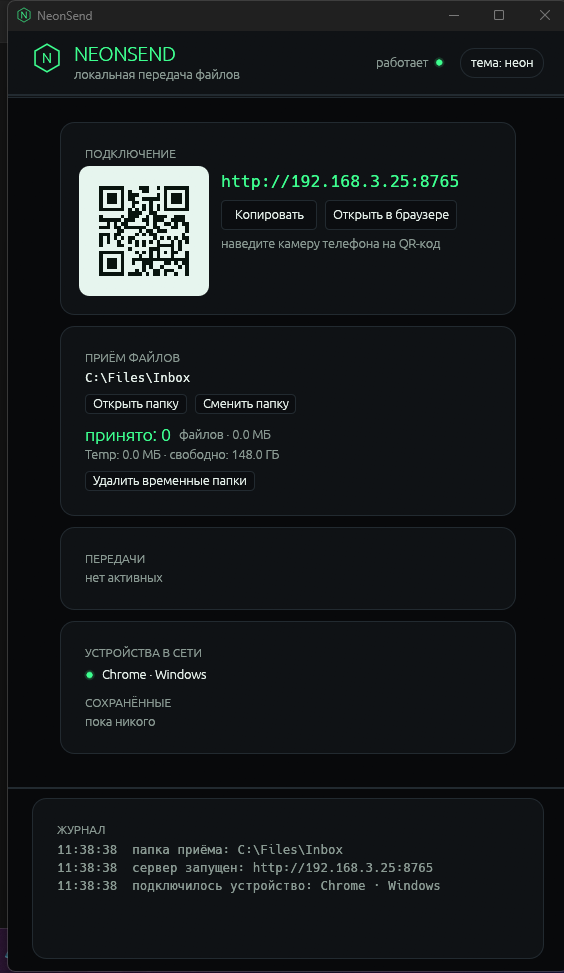

# NeonSend

Передача файлов между компьютером и телефоном по локальной сети. Один `.exe` на Windows, клиенты — обычные браузеры: ничего не нужно устанавливать на телефон, планшет или второй компьютер.



## Как это работает

1. Запускаете `neonsend.exe` на компьютере.
2. В окне появляются QR-код и адрес вида `http://192.168.1.10:8765`.
3. Сканируете QR телефоном (или открываете адрес в браузере) — устройство появляется в списке.
4. Выбираете получателя, файлы или отправляете текст.

Файлы идут напрямую по локальной сети, без облака и интернета. Сервер живёт внутри приложения, данные — в памяти процесса и в папке приёма на диске.

## Возможности

- Передача файлов и текста между любым количеством устройств в одной сети (телефон ↔ ПК, телефон ↔ телефон через ПК).
- Несколько файлов за раз, очередь, прогресс, отмена.
- Докачка прерванной загрузки и выбор поведения при совпадении имён (пропустить / заменить / сохранить оба).
- Пакетное скачивание всех принятых файлов одним нажатием.
- Настраиваемая папка приёма, временные папки с автоматической очисткой кнопкой или при выходе.
- Тёмная и светлая темы, QR-код, копирование адреса, запуск страницы в браузере.
- Клиентская страница не хранит файлы: всё скачивается в «Загрузки» браузера.

## Требования

- Windows 10 или 11, 64-бит.
- Устройства в одной локальной сети (одна Wi-Fi/Ethernet-сеть).
- Открытый порт 8765 (если занят — приложение возьмёт 8766–8790 и покажет фактический адрес).

## Скачать

Готовый `neonsend.exe` лежит в разделе **Releases**. Установщик не нужен: скопируйте файл и запустите.

При первом запуске Windows спросит доступ в сеть — разрешите его для **частной** сети, иначе телефон не подключится. Файл не подписан сертификатом, поэтому SmartScreen может показать предупреждение: «Подробнее» → «Выполнить всё равно».

## Быстрый старт

1. Запустить `neonsend.exe`.
2. Разрешить доступ в брандмауэре для частной сети.
3. Убедиться, что сеть в Windows — «Частная», а адрес в окне соответствует вашей сети (например, `192.168.1.x`).
4. Навести камеру телефона на QR или открыть адрес вручную.
5. Выбрать устройство и отправить файлы.

Если адрес не тот (несколько адаптеров, VPN), выберите нужную сеть в строке «сеть:» под адресом — она появляется, когда у компьютера больше одного локального адреса.

## Ограничения

- Файлы больше 64 МБ скачиваются браузером напрямую по ссылке — прогресс в интерфейсе для них не показывается.
- Вкладка должна оставаться открытой: закрыли — передача прервётся. В фоновой вкладке соединение восстанавливается автоматически.
- Работает только по HTTP внутри локальной сети, без TLS: не используйте в гостевых и общедоступных сетях.
- Гостевая Wi-Fi с изоляцией клиентов (AP isolation) не подойдёт — устройства просто не увидят друг друга.
- IPv6 не поддерживается.

## Безопасность

- Приложение рассчитано на доверенную домашнюю сеть. Каждое устройство получает токен в браузере; запросы без токена и запросы от имени чужого устройства отклоняются.
- Проверяются заголовки `Host` и `Origin` — страница не откроется по чужому имени и не встроится в iframe на стороннем сайте.
- Передача не шифруется. В сети, где есть незнакомые устройства, используйте что-то другое.

## Сборка из исходников

Нужен [Rust](https://rustup.rs) (stable, 1.80+):

```bash
cargo build --release
```

Результат — `target/release/neonsend.exe`. Сборка проверена на `x86_64-pc-windows-gnu` и `x86_64-pc-windows-msvc`; внешних DLL, кроме системных, не требуется.

Тесты:

```bash
cargo test --release          # 7 тестов сервера
node tests/ui_smoke.mjs       # проверка клиентской страницы в headless Chrome
```

## Документация

- [ARCHITECTURE.md](ARCHITECTURE.md) — устройство приложения, протокол, модель данных.
- [AUDIT/](AUDIT/) — аудит кода и безопасности, результаты тестов, план исправлений.
- [DECISIONS.md](DECISIONS.md) — принятые решения и их причины.

## Лицензия

MIT — см. [LICENSE](LICENSE).
